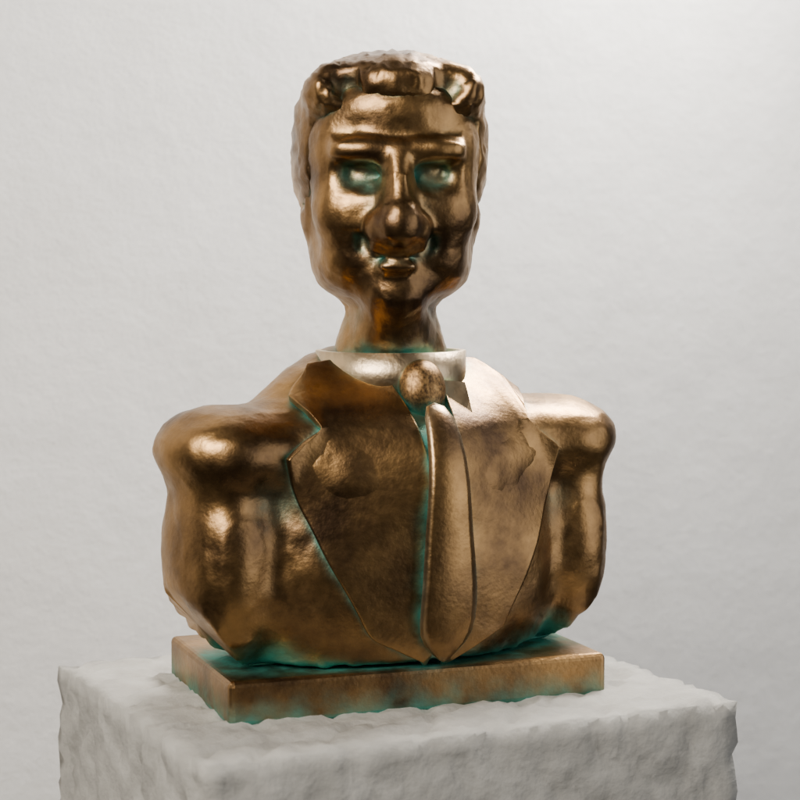

# Bronze portrait bust — Blender build

A procedural Blender scene that models a patinated bronze bust of a man in a
suit and tie, standing on a bronze base plate over a rough-hewn stone plinth in
front of a plaster wall. Everything is generated by one script; nothing is
hand-sculpted.



## Files

| Path | What it is |
|---|---|
| `bronze_bust.py` | The build script (geometry, materials, lights, camera, export) |
| `output/bust.blend` | Full scene, editable in Blender 4.2+ / 5.x (modifiers live) |
| `output/bust.glb` | Bust only, modifiers applied, PBR materials — for web/AR/other DCCs |
| `output/preview.png` | Cycles render, 1024 px, 128 samples |

`bust.obj` / `bust.mtl` are also written by the script but are git-ignored
because of size; regenerate them locally with the command below.

## Regenerate

With the `bpy` pip module (no Blender install needed; Python 3.11):

```bash
pip install bpy
python3 blender/bronze_bust.py --out blender/output --res 1024 --samples 128
```

Or inside a Blender install:

```bash
blender -b -P blender/bronze_bust.py -- --out blender/output
```

Options: `--res` (square render size), `--samples`, `--mb-res` (metaball
resolution, 0.010 default; smaller = finer mesh), `--no-render`, `--no-export`.
A 1024 px / 128-sample CPU render takes about three minutes on four cores.

## How it is built

* **Head, hair, neck, torso** are metaball unions (`ELLIPSOID` / `BALL`
  elements, some negative for eye sockets, philtrum, lip line, hairline). The
  helpers take *visible* sizes and scale the field radius so the numbers in the
  script are real half-extents in metres.
* The torso is then bisected into the classic bust silhouette: a flat bottom,
  two slanted arm cuts and a slight back cut, with the holes capped.
* **Lapels, tie blade** are drawn flat in the XZ plane, subdivided, then draped
  onto the jacket surface by ray-casting against a BVH of the evaluated torso,
  so they follow the chest and wrap round the sides. Solidify gives them
  thickness. The **tie knot** is placed on the surface the same way.
* **Shirt collar** (band + two points) is parented to the head so it follows
  the head turn.
* Surface: subdivision + Displace modifiers (Voronoi clouds) for hammered
  bronze on the jacket, fine tooling on the face, combed strands on the hair
  (a stretched empty drives the strand texture coordinates).
* **Material**: Principled BSDF, metallic 1. Base colour mixes warm bronze and
  dark bronze by large-scale noise, verdigris in recesses via an Ambient
  Occlusion node × fine noise, and polished highlights on convex edges via
  Geometry → Pointiness. Roughness follows the patina. Micro bump for tooling.
* **Lighting**: three area lights (warm key upper-left, cool fill right, rim
  from behind), grey world, AgX view transform at −1.2 EV.

## Limits, and how to get a true likeness

This is a *stylised* procedural bust: the proportions, the notch-lapel suit,
the knotted tie, the swept-back hair, the bronze-with-verdigris finish and the
plinth follow the reference, but a sculpted human face cannot be matched
feature-for-feature with primitives. For an exact likeness the workflow is:

1. Photogrammetry (many photos around the real object, Meshroom or
   RealityCapture) or an image-to-3D model (Hunyuan3D, TripoSR) from the
   reference photo, to get a base mesh.
2. Import the mesh into `bust.blend`, replace the metaball head/torso, and
   refine in Sculpt Mode (Clay Strips, Crease, Smooth) with the reference set
   as a background image.
3. Keep the material, lights and camera from this scene — they already match
   the look.
